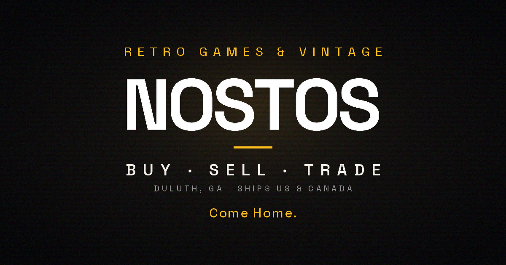

  

NOSTOS is a retro video game and vintage store in Duluth, Georgia, the kind of store Gwinnett County has needed for a long time. Every item is graded, priced transparently against live market data, and displayed like it matters. Because it does. We carry imports and Japanese exclusives that most US stores don't stock: Super Famicom, PC Engine, Famicom Disc System, Neo Geo, and more. We repair hardware. We do trade-ins the right way: live pricing on the counter, no guessing, no lowballing. If you grew up with a controller in your hand, wherever in the world that was, you'll find something here.

### Made here, free for everyone

**[Timeline](https://github.com/nostoshq/timeline)** is a home screen for retro handhelds: every console on one
timeline, in the order it came out, set up to look and play the way it did.

[nostos.market](https://nostos.market)
